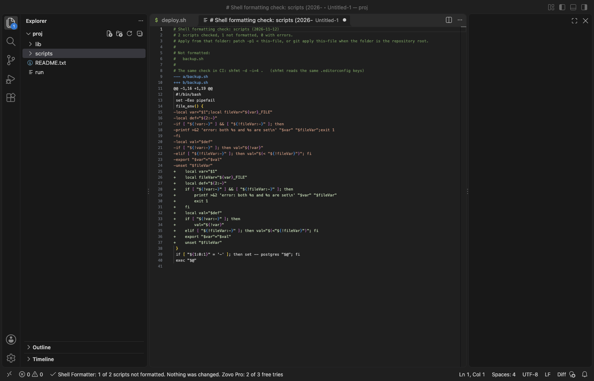

# Shell Formatter for Bash & Zsh

Format bash, sh, zsh, bats and mksh scripts in VS Code with shfmt built in. The shfmt engine ships inside the extension as WebAssembly, so there is nothing to download or install. Free, no sign-in, works offline.

Free, with no limits:

- Format Document (Shift+Alt+F, Shift+Option+F on macOS), Format Selection and format on save.
- The same output as the shfmt 3.14.1 command line tool, byte for byte: 354 of 354 runs on 178 real scripts from GitHub projects and Homebrew, with two option sets. The 19 scripts that shfmt itself rejects get the same error.
- Reads the shfmt keys from .editorconfig, so the editor, your team and CI agree.
- A syntax error leaves the file unchanged and shows the line and column in the Problems panel.
- Same commands check: before a change is applied, the formatted script is parsed again and must run the same commands as the original.
- Never touches Dockerfiles, .env files, fish or csh scripts.
- A 2 MB script formats in about 0.2 s. Files over 10 MB get a message instead of a frozen editor.

Zovo Pro: USD 19 once, for the Pro tools in every Zovo extension. Each Pro tool below has 3 free tries on this computer, and a try is used only when the tool gives you a result:

- Format All Shell Scripts in a Folder: checks every script in a folder and its subfolders (by name, or by a `#!` line naming a shell), says how many would change, then formats them all or gives a Markdown report.
- Formatting Check with a Patch File: changes nothing and opens one unified diff of what formatting would do, with the list of scripts that are not formatted and the `shfmt -d` command for CI. Apply it with `patch -p1` or `git apply`.
- Minify a Script to a Copy: writes `name.min.sh` next to the script with comments and spacing removed (shfmt -s, then -mn), keeps the `#!` line, and parses the copy again to check that it has the same commands. The original stays as it is.

Run them from the Command Palette, the status bar menu, or right-click a folder (or a script, for Minify) in the Explorer: the entries start with "Zovo Pro:". The folder tools read each script's indentation the way the editor does, and follow your settings and .editorconfig.

## How to use

1. Install the extension.
2. Open a shell script and press Shift+Alt+F (Shift+Option+F on macOS). If VS Code asks which formatter to use, pick Shell Formatter, or run Shell Formatter: Use as Default Formatter for Shell Scripts.
3. To format each time you save, run Shell Formatter: Turn On Format on Save for Shell Scripts.

Click shfmt 3.14.1 in the status bar for the menu: format, set as default, format on save, copy the matching shfmt command for CI, settings.

## Dialects

The dialect comes from the first line (`#!/bin/bash`, `#!/bin/sh`, `#!/usr/bin/env zsh`, ...), then from the file name (`.bash`, `.zsh`, `.zshrc`, `.bats`, `.ksh`), else bash. That is the same order as shfmt. If a file with no first line uses features of another dialect (for example zsh anonymous functions in a `.sh` file), the formatter tries the dialect the parser names. Set `shellFormatter.dialect` or `shell_variant` in `.editorconfig` to choose it yourself.

Zsh support in shfmt is new. A zsh script that shfmt cannot parse is left unchanged.

## Settings

| Setting | Default | shfmt flag | .editorconfig key |
|---|---|---|---|
| `shellFormatter.dialect` | `auto` | `-ln` | `shell_variant` |
| `shellFormatter.indent` | follow the editor | `-i` | `indent_style`, `indent_size` |
| `shellFormatter.binaryNextLine` | off | `-bn` | `binary_next_line` |
| `shellFormatter.switchCaseIndent` | off | `-ci` | `switch_case_indent` |
| `shellFormatter.spaceRedirects` | off | `-sr` | `space_redirects` |
| `shellFormatter.keepPadding` | off | `-kp` | `keep_padding` |
| `shellFormatter.functionNextLine` | off | `-fn` | `function_next_line` |
| `shellFormatter.simplify` | off | `-s` | `simplify` |
| `shellFormatter.minify` | off | `-mn` | `minify` |
| `shellFormatter.useEditorConfig` | on | | |
| `shellFormatter.verifyCommands` | on | | |
| `shellFormatter.skipFiles` | `.env`, `.env.*`, `*.env` | | `ignore = true` |
| `shellFormatter.maxFileMB` | 10 | | |
| `shellFormatter.timeoutSeconds` | 10 | | |

The defaults are the shfmt defaults. A key in `.editorconfig` wins over the setting, so a project file decides for everyone who opens the project. Without either, the indent follows the editor: tabs, or spaces with the editor's tab size.

## Large and unusual files

- Files up to 2 MB format in well under 2 seconds (about 0.2 s on an Apple M-series Mac).
- Files over `shellFormatter.maxFileMB` (10 MB) are not formatted and a message says why.
- shfmt runs in a separate worker thread with a time limit, so a script with thousands of nested subshells cannot freeze the editor. If the limit is reached, the file is unchanged.
- A file with binary bytes (NUL), such as a self-extracting installer, is not formatted.
- Windows line ends (CRLF) stay CRLF.

## Privacy

No network requests, no telemetry, no account. The formatter reads only the open script and the `.editorconfig` files above it. The only links that leave VS Code are the Rate, Sponsor and More free tools links, and only when you click them.

## Support Zovo

Zovo Pro: USD 19 once, every Zovo viewer. [Get Zovo Pro on GitHub Sponsors](https://github.com/sponsors/theluckystrike/sponsorships?tier_id=679878) to turn on the Pro tools in this extension and in the other Zovo extensions you use. The free features stay free.

Zovo extensions have no ads and no tracking. They are made by [theluckystrike](https://github.com/theluckystrike) on GitHub. You can also support the work with no Pro:

- [Sponsor on GitHub](https://github.com/sponsors/theluckystrike)
- [PayPal](https://www.paypal.com/paypalme/najzzz)
- [Follow theluckystrike on GitHub](https://github.com/theluckystrike)

## More tools by Zovo

- [PDF Viewer & PDF Reader to Read and View PDF (Dark Mode)](https://marketplace.visualstudio.com/items?itemName=zovo.pdf-viewer-dark) reads PDFs with a real dark mode, search, an outline and thumbnails.
- [XLSX Viewer, Excel Viewer, CSV Viewer & Parquet Viewer (XLS, CSV Preview)](https://marketplace.visualstudio.com/items?itemName=zovo.table-viewer-vscode) opens CSV, TSV, Excel and Parquet files as a sortable, filterable table.
- [DOCX Viewer & ODT Viewer, Word Document Preview (Dark Mode)](https://marketplace.visualstudio.com/items?itemName=zovo.docx-viewer-vscode) previews Word and ODT files with dark mode, an outline and search.

See [all Zovo extensions on the Marketplace](https://marketplace.visualstudio.com/publishers/zovo).

## License

MIT. shfmt (mvdan/sh) is BSD-3-Clause and sh-syntax is MIT; see [THIRD-PARTY-NOTICES.md](THIRD-PARTY-NOTICES.md).
