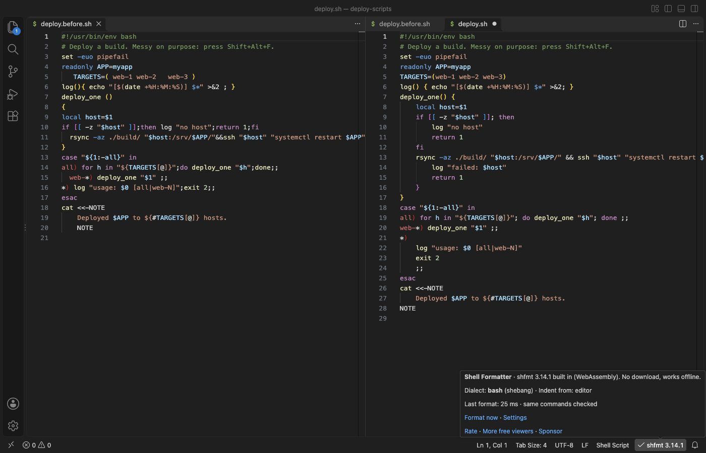
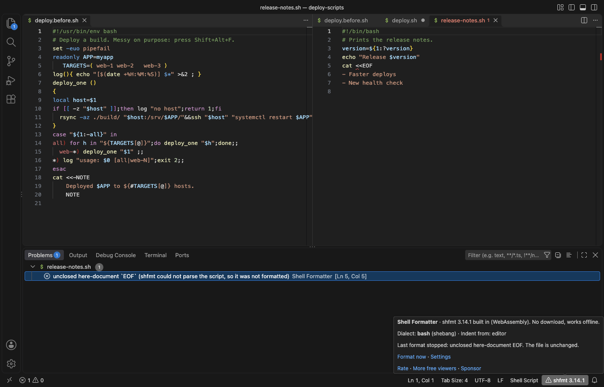

# Bash & Shell Script Formatter with shfmt built in

Format bash, sh, zsh and bats scripts in VS Code with shfmt. The shfmt engine ships inside the extension, so there is nothing to download or install. Free, no sign-in, works offline.

- Format Document (Shift+Alt+F, Shift+Option+F on macOS), Format Selection and format on save.
- The same output as the shfmt 3.14.1 command line tool, byte for byte: 354 of 354 runs on 178 real scripts from GitHub projects and Homebrew, with two option sets. The 19 scripts that shfmt itself rejects get the same error.
- Reads the shfmt keys from .editorconfig, so the editor, your team and CI agree.
- A syntax error leaves the file unchanged and shows the line and column in the Problems panel.
- Same commands check: before a change is applied, the formatted script is parsed again and must run the same commands as the original.
- Never touches Dockerfiles, .env files, fish or csh scripts.
- A 2 MB script formats in about 0.2 s. Files over 10 MB get a message instead of a frozen editor.

## Why this one

The most installed shell formatter on the Marketplace downloads a separate shfmt program the first time it runs. Its most discussed GitHub issues come from that design and from formatting files that are not shell scripts. Each point below links the issue and says what this extension does instead.

| Problem reported by users | Issues | What Shell Formatter does |
|---|---|---|
| "There is no formatter for shellscript files installed" after an update or a failed download | [#396](https://github.com/foxundermoon/vs-shell-format/issues/396) (94 comments, 119 reactions), [#402](https://github.com/foxundermoon/vs-shell-format/issues/402), [#401](https://github.com/foxundermoon/vs-shell-format/issues/401), [#405](https://github.com/foxundermoon/vs-shell-format/issues/405), [#295](https://github.com/foxundermoon/vs-shell-format/issues/295) | shfmt is compiled to WebAssembly and packed in the extension. The formatter is ready as soon as a shell script opens. The release gate installs the package in an empty VS Code profile with no network step and formats 34 files. |
| A program is downloaded without asking; offline, Apple Silicon, WSL, Remote SSH and dev containers fail | [#46](https://github.com/foxundermoon/vs-shell-format/issues/46), [#39](https://github.com/foxundermoon/vs-shell-format/issues/39), [#230](https://github.com/foxundermoon/vs-shell-format/issues/230), [#136](https://github.com/foxundermoon/vs-shell-format/issues/136), [#147](https://github.com/foxundermoon/vs-shell-format/issues/147), [#393](https://github.com/foxundermoon/vs-shell-format/issues/393) | No download and no native program. The same WebAssembly file runs on macOS, Linux and Windows, on Intel and ARM, locally and on a remote host. |
| Dockerfiles broken (a trailing backslash removed), crontabs and other files formatted | [#304](https://github.com/foxundermoon/vs-shell-format/issues/304) (37 reactions), [#176](https://github.com/foxundermoon/vs-shell-format/issues/176) (25 reactions), [#258](https://github.com/foxundermoon/vs-shell-format/issues/258), [#62](https://github.com/foxundermoon/vs-shell-format/issues/62) | It formats only shell scripts and bats files. Dockerfiles, `.env` files, fish and csh scripts are never changed. The gate checks a Dockerfile and a `.env` file. |
| .editorconfig ignored; settings not per folder | [#66](https://github.com/foxundermoon/vs-shell-format/issues/66), [#64](https://github.com/foxundermoon/vs-shell-format/issues/64) | `.editorconfig` is read for each file, with the same keys as shfmt. Every setting can be set per workspace folder. |
| Errors in a popup, no line number | [#231](https://github.com/foxundermoon/vs-shell-format/issues/231), [#37](https://github.com/foxundermoon/vs-shell-format/issues/37) | The error goes to the Problems panel at the line and column shfmt reports. The status bar item turns yellow. Nothing pops up. |
| Scripts without a `.sh` ending | [#308](https://github.com/foxundermoon/vs-shell-format/issues/308) | VS Code opens files with a `#!/bin/bash` or `#!/bin/sh` first line as shell scripts, and the dialect comes from that line. |

Issue numbers and counts were read from GitHub on 2026-11-08.

## How to use

1. Install the extension.
2. Open a shell script and press Shift+Alt+F (Shift+Option+F on macOS). If VS Code asks which formatter to use, pick Shell Formatter, or run Shell Formatter: Use as Default Formatter for Shell Scripts.
3. To format each time you save, run Shell Formatter: Turn On Format on Save for Shell Scripts.

Click shfmt 3.14.1 in the status bar for the menu: format, set as default, format on save, copy the matching shfmt command for CI, settings.

## Dialects

The dialect comes from the first line (`#!/bin/bash`, `#!/bin/sh`, `#!/usr/bin/env zsh`, ...), then from the file name (`.bash`, `.zsh`, `.zshrc`, `.bats`, `.ksh`), else bash. That is the same order as shfmt. If a file with no first line uses features of another dialect (for example zsh anonymous functions in a `.sh` file), the formatter tries the dialect the parser names. Set `shellFormatter.dialect` or `shell_variant` in `.editorconfig` to choose it yourself.

Zsh support in shfmt is new. A zsh script that shfmt cannot parse is left unchanged.

## Settings

| Setting | Default | shfmt flag | .editorconfig key |
|---|---|---|---|
| `shellFormatter.dialect` | `auto` | `-ln` | `shell_variant` |
| `shellFormatter.indent` | follow the editor | `-i` | `indent_style`, `indent_size` |
| `shellFormatter.binaryNextLine` | off | `-bn` | `binary_next_line` |
| `shellFormatter.switchCaseIndent` | off | `-ci` | `switch_case_indent` |
| `shellFormatter.spaceRedirects` | off | `-sr` | `space_redirects` |
| `shellFormatter.keepPadding` | off | `-kp` | `keep_padding` |
| `shellFormatter.functionNextLine` | off | `-fn` | `function_next_line` |
| `shellFormatter.simplify` | off | `-s` | `simplify` |
| `shellFormatter.minify` | off | `-mn` | `minify` |
| `shellFormatter.useEditorConfig` | on | | |
| `shellFormatter.verifyCommands` | on | | |
| `shellFormatter.skipFiles` | `.env`, `.env.*`, `*.env` | | `ignore = true` |
| `shellFormatter.maxFileMB` | 10 | | |
| `shellFormatter.timeoutSeconds` | 10 | | |

The defaults are the shfmt defaults. A key in `.editorconfig` wins over the setting, so a project file decides for everyone who opens the project. Without either, the indent follows the editor: tabs, or spaces with the editor's tab size.

## Large and unusual files

- Files up to 2 MB format in well under 2 seconds (about 0.2 s on an Apple M-series Mac).
- Files over `shellFormatter.maxFileMB` (10 MB) are not formatted and a message says why.
- shfmt runs in a separate worker thread with a time limit, so a script with thousands of nested subshells cannot freeze the editor. If the limit is reached, the file is unchanged.
- A file with binary bytes (NUL), such as a self-extracting installer, is not formatted.
- Windows line ends (CRLF) stay CRLF.

## Privacy

No network requests, no telemetry, no account. The formatter reads only the open script and the `.editorconfig` files above it. The only links that leave VS Code are the Rate, Sponsor and More free tools links, and only when you click them.

## Support Zovo

Zovo extensions are free, with no ads and no tracking. They are made by [theluckystrike](https://github.com/theluckystrike) on GitHub. If this one saves you time, you can support the work:

- [Sponsor on GitHub](https://github.com/sponsors/theluckystrike)
- [PayPal](https://www.paypal.com/paypalme/najzzz)
- [Follow theluckystrike on GitHub](https://github.com/theluckystrike)

## More tools by Zovo

- [HAR Viewer & HAR File Analyzer (HTTP Archive, Network Log)](https://marketplace.visualstudio.com/items?itemName=zovo.zovo-har-viewer) opens HAR files from browser DevTools with a timing waterfall, filters and a redacted copy for sharing.
- [Large JSON Viewer, JSON Browser & JSON Tree](https://marketplace.visualstudio.com/items?itemName=zovo.zovo-json-tree-viewer) shows large JSON files as a searchable tree, copies JSONPath and turns arrays of objects into a table.
- [ZIP Viewer & Archive Explorer (JAR, TAR, GZ)](https://marketplace.visualstudio.com/items?itemName=zovo.zip-archive-explorer) browses ZIP, JAR, VSIX, TAR and GZ files, opens entries in tabs and extracts them safely.
- [Hex Viewer & Binary Viewer, Hex Editor (Large Files)](https://marketplace.visualstudio.com/items?itemName=zovo.zovo-hex-viewer) opens files of any size in under a second, with a data inspector and byte-by-byte compare.
- [JSONL Viewer, Large JSONL Table & NDJSON Viewer](https://marketplace.visualstudio.com/items?itemName=zovo.zovo-jsonl-viewer) opens JSONL and NDJSON files as a table, as records or as a chat view.

See [all Zovo extensions on the Marketplace](https://marketplace.visualstudio.com/publishers/zovo).

## License

MIT. shfmt (mvdan/sh) is BSD-3-Clause and sh-syntax is MIT; see [THIRD-PARTY-NOTICES.md](THIRD-PARTY-NOTICES.md).
